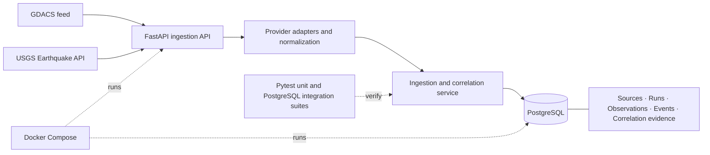

# Live Disaster Monitoring Platform

A data engineering project for collecting, normalizing, and correlating disaster observations from multiple public providers. The current implementation milestone covers earthquake observations from GDACS and the USGS Earthquake API.

## Current implementation

- Separate GDACS and USGS adapters fetch and normalize their provider-specific GeoJSON payloads. Each provider has independent error handling, so one provider's failure does not prevent the other from being processed.
- `POST /ingestion/earthquakes/run` starts a one-shot ingestion run. `GET /health` checks the API's PostgreSQL connection.
- PostgreSQL is the persistent store. The existing canonical `events` model represents platform event identity; provider record identity remains in source observations.
- The `sources` registry, `ingestion_runs`, and `source_observations` track providers, run outcomes, and provider-specific records. `earthquake_observations` stores normalized earthquake fields and the current and immediately previous values for selected mutable fields.
- Correlation records decisions and candidate evidence. Origin times must be within 120 seconds and epicenters within 75 km; magnitude is supporting evidence only. Only a unique candidate meeting the confidence threshold is linked automatically. Ambiguous candidates remain unresolved for review.
- Raw provider feature JSON is stored inline in PostgreSQL JSONB and refreshed on fetch. The payload expires after 90 days and is cleared on the next ingestion run after expiry; normalized observation data remains. Payload version history is not retained.
- Observation persistence is idempotent by source plus provider record ID. Provider failures are recorded per run, and the healthy provider continues. A provider batch is committed atomically; a failed batch is rolled back and its run is marked failed.
- MongoDB is present as an optional Compose service for the wider project setup, but is not used by the earthquake ingestion path. PostGIS is not required; the current correlator uses a great-circle distance calculation in Python.

## Architecture



Python, FastAPI, SQLAlchemy, Pydantic Settings, Alembic, and PostgreSQL form the application stack. Docker Compose defines the local PostgreSQL and API services, an optional MongoDB service, and a separate disposable PostgreSQL integration-test service. Alembic migrations define the persistent schema; pytest covers provider normalization, correlation, persistence, API behavior, and PostgreSQL-specific workflows.

## Setup

Prerequisites: Windows PowerShell, Python 3.13, Docker Compose for PostgreSQL-backed integration tests (and optional containerized development), and Git.

From the repository root, create a virtual environment and install application and development dependencies:

```powershell
py -3.13 -m venv ingestion\.venv
.\ingestion\.venv\Scripts\python.exe -m pip install -r ingestion\requirements-dev.txt
Copy-Item .env.example .env
```

Edit `.env` with your own local PostgreSQL and optional MongoDB settings. `.env.example` contains example values only; do not commit `.env` or share credentials. The host application and Alembic use the shared Pydantic Settings resolver and the development `DATABASE_URL` from `.env`.

To start the Compose PostgreSQL service, run:

```powershell
docker compose up -d postgres
```

Do not apply migrations to an existing database until its baseline and Alembic revision have been checked. The migration at the current head is forward-only; it must not be used to reset an existing database.

## Development database commands

Use `scripts/dev.ps1` for host-side development operations. It runs in a child PowerShell process, clears inherited integration-test overrides there, and leaves the caller's environment unchanged. It displays a sanitized target; migration operations also report current and pending revisions before proceeding. Credentials and the full connection URL are not displayed.

```powershell
# Inspect the resolved development target (no database connection)
powershell.exe -NoProfile -ExecutionPolicy Bypass -File ./scripts/dev.ps1 -Operation Target

# Read current revision and pending revisions (read-only preflight, then Alembic current)
powershell.exe -NoProfile -ExecutionPolicy Bypass -File ./scripts/dev.ps1 -Operation Alembic -AlembicArguments current

# Check model and migration consistency
powershell.exe -NoProfile -ExecutionPolicy Bypass -File ./scripts/dev.ps1 -Operation Alembic -AlembicArguments check

# Apply pending migrations after reviewing the target and preflight output
powershell.exe -NoProfile -ExecutionPolicy Bypass -File ./scripts/dev.ps1 -Operation Migrate

# Start the host-side API
powershell.exe -NoProfile -ExecutionPolicy Bypass -File ./scripts/dev.ps1 -Operation Api
```

`Migrate` invokes `alembic upgrade head` only after validating the development target and displaying its migration state. The launcher rejects the configured integration-test endpoint. Use `docker compose` separately when running the containerized API.

## Testing

Run unit and mock-based tests with the repository virtual environment:

```powershell
.\ingestion\.venv\Scripts\python.exe -m pytest -q tests --ignore=tests/postgres_integration
```

Run the PostgreSQL integration tests only through the isolated launcher:

```powershell
powershell.exe -NoProfile -ExecutionPolicy Bypass -File ./scripts/run-postgres-integration.ps1
```

The launcher uses `docker-compose.integration.yml`, a dedicated loopback port and disposable PostgreSQL storage. Its test-only environment is confined to a child process; the development `.env` and caller's PowerShell variables are not used for the test database. Integration tests create and drop only generated test databases on that isolated service. Do not substitute the development database URL.

## Data model and migration history

The migration chain is:

1. `36eab4f3c6a6` — original canonical events, geometries, and episodes.
2. `9f3b7e21a6c4` — initial provider ingestion tables.
3. `b4a2d91f63e8` — reconciled shared disaster model and correlation evidence.

The canonical `events.id` is platform identity. Legacy provider/source IDs remain nullable on events for exact legacy matching; new provider identities live in `source_observations`. GDACS event and episode identifiers remain distinct. `episode_observations` permits linking provider observations to a meaningful canonical episode, while routine provider revisions do not create episodes.

`event_correlations` stores decision history, rationale, method/version, confidence, and decision time; `event_correlation_candidates` stores candidate-level measurements and selection. Current correlation does not require PostGIS.

The local development database is separate from the PostgreSQL integration service on `127.0.0.1:55432`. The latest reported development verification has Alembic revision `b4a2d91f63e8`, and the latest reported `alembic check` found no new upgrade operations. The PostgreSQL integration suite uses its own disposable database and does not establish the state of the development database.

## Project status and roadmap

### Implemented

- GDACS and USGS earthquake adapters, normalization, timeout/error handling, and deterministic fixture tests.
- PostgreSQL provider/run/observation persistence, idempotent provider-record upserts, current/previous values, canonical event linking, and candidate decision evidence.
- Conservative time-and-distance correlation with unresolved handling for ambiguous candidates.
- FastAPI health and one-shot ingestion endpoints.
- Alembic migration chain and isolated PostgreSQL integration workflow.
- Development and test launchers that separate database configuration.

### Verification limits

Fresh and legacy migrations, schema consistency, service and API paths, and PostgreSQL integration behavior have been exercised in the disposable test environment according to the latest reported results. **Live GDACS/USGS ingestion against the development database has not been verified.** A successful development-database migration or API run should not be inferred from the isolated integration results.

### Planned work

- Airflow orchestration and scheduled ingestion.
- Additional hazard providers and hazard-specific data models.
- Operational monitoring, deployment hardening, and richer review workflows for unresolved correlations.
- Evaluate spatial database support if future query patterns require it.
